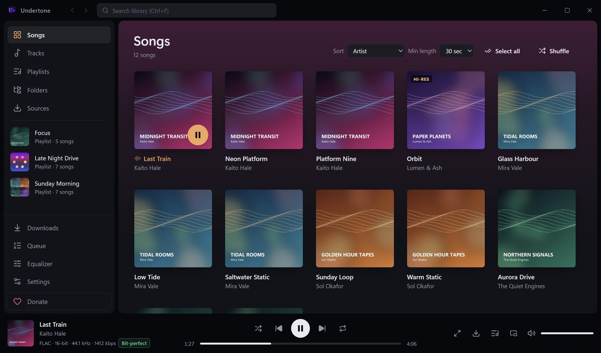
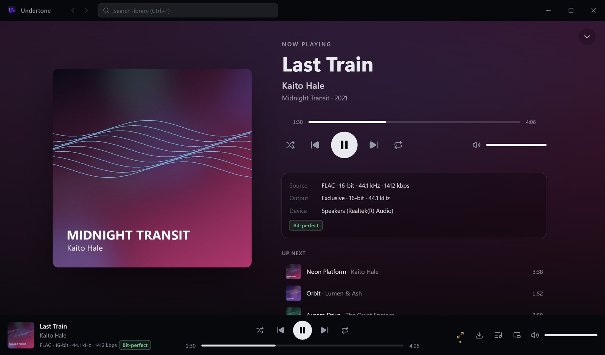
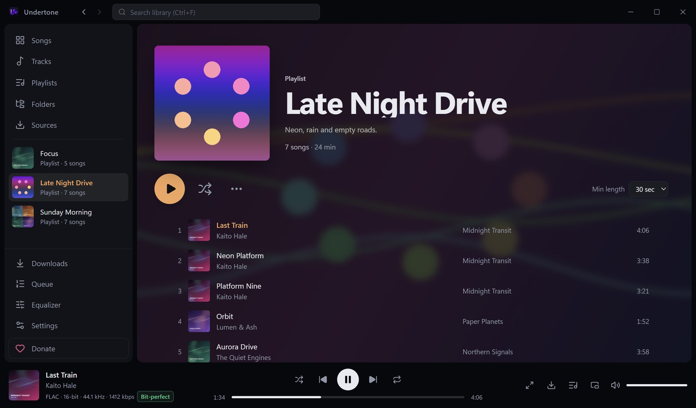

# Undertone

A personal, **local-only** music player for Windows. No telemetry. The only network use is the update check, reading playlist links you paste, lyrics searches you ask for, Soulseek once you sign in, and YouTube downloads once you turn them on.

Formerly called Resonance. The data folder (`app.resonance.player`) and backup file format still
use the old name so existing libraries and backups keep working.

Built with **Tauri 2** (Rust backend) and **React + TypeScript + Tailwind** (frontend).
Open source under the [MIT License](LICENSE).



| Now Playing | A playlist with a video background and a GIF cover |
|---|---|
|  |  |

<sub>The screenshots use a made-up demo library.</sub>

## Download

Get the latest `Undertone_<version>_x64-setup.exe` from the
[Releases page](https://github.com/giorgigorokhovi17/resonance/releases/latest) and run it.
It installs for your user only (no admin rights needed) and adds Start-menu and Desktop shortcuts.
Installed copies check that page for updates and offer to install them.

Windows 10 or 11, 64-bit. WebView2 is preinstalled on Windows 11; the installer adds it on
Windows 10 if it's missing.

The installer isn't code-signed yet, so Windows SmartScreen may say "Windows protected your PC"
and "Unknown publisher". Click **More info**, then **Run anyway**.

Undertone is free. If you'd like to support it, you can donate on
[Kisa](https://www.kisa.ge/donate/zhg15pbjbz); the **Donate** button in the app opens the same page.

**"Windows protected your PC"**: the installer isn't code-signed (a signing certificate costs
money every year), so SmartScreen warns about it the first few times. Click **More info → Run
anyway**. Updates are still verified: the app only installs updates signed with the project's
own update key.

## Features

**Audio engine (Rust)**
- Decoding with `symphonia`: FLAC, WAV, AIFF, ALAC and AAC (`.m4a`), MP3, Ogg Vorbis. Opus is decoded through libopus (`symphonia-adapter-libopus`). Supports up to 32-bit / 384 kHz.
- Two output modes, switchable live in **Settings → Audio output**:
  - **Shared** (default): WASAPI shared mode via `cpal`, going through the Windows mixer, so Equalizer APO and other system effects still apply. If the file's sample rate differs from the device's mix rate, it is converted once with a high-quality 64-bit sinc resampler (`rubato`).
  - **Exclusive**: raw WASAPI exclusive mode (event-driven, via the `wasapi` crate, because `cpal` has no exclusive mode). The device is opened at each file's **native sample rate and bit depth**: no mixer and no resampling. 24-bit audio is sent packed or in a 32-bit container, whichever the device accepts. 16-bit audio is zero-padded into wider containers, which is lossless. If a device cannot do a rate in exclusive mode, that track falls back to shared mode and the app shows a notice.
- **Gapless playback**: the next track is decoded ahead into the same stream, and encoder delay/padding is trimmed. Tracks that need a different device format in exclusive mode trigger a device reopen (a short, unavoidable gap).
- **Sample-accurate seeking** and 64-bit float processing throughout. Samples are scaled by exact powers of two, so with volume at 100% and the EQ bypassed, exclusive mode is **bit-perfect**. A "Bit-perfect" badge confirms it live.
- **10-band parametric EQ + preamp** (RBJ biquads in f64): peak, low/high shelf, low/high-pass. Bypass toggle, built-in and saved presets, and **AutoEQ `ParametricEQ.txt` import**. *Auto headroom* lowers the preamp by the EQ's peak boost so boosts can never clip.
- **Crossfade** (Settings → Crossfade, off by default, 1–10 s): an equal-power fade from each song into the next. Songs from the same album stay gapless. Only the overlap itself isn't bit-perfect.
- **ReplayGain** (track/album) with pre-amp. Gain is limited by the stored peak so it never clips.
- Volume uses a smooth perceptual taper with de-click ramps. TPDF dither is applied only when the signal was actually processed.

**Library**
- Add one or more music folders. They're scanned recursively and in parallel; tags and properties are read with `lofty`. Album art comes from embedded pictures or folder images (`cover.jpg`, `folder.png`, …), cached as thumbnails.
- Stored in local SQLite (WAL). Rescans are incremental: only new or changed files are re-read.
- Folders are watched for changes, which triggers an automatic incremental rescan.
- Views: **Songs** (cover grid), **Tracks** (sortable table), **Playlists**, **Folders** and **Search**. Long lists are virtualized.
- **Your stats**: top songs, artists and albums, minutes listened, when you listen (by hour and weekday), longest streak and biggest day, for this month, the last 30 days, this year or all time. A song counts once you've heard 30 seconds of it (half of songs under a minute). The history stays in the local database; **Clear listening history** at the bottom of the page deletes it.

**Playback UI**
- Dark (default) and light themes. Large **Now Playing** view with album art over a blurred-art background.
- **Custom photos, GIFs and short videos**: as a song's artwork (**Set artwork…**), as a playlist's cover, behind a playlist's page (**Edit details → Background**), and as the app's background (**Settings → Visual → Background**, behind the whole app or only Now Playing). Every GIF or video keeps a still first frame, which lists, colour extraction, the Windows media overlay, the tray and backups use. Videos never play sound.
  - Formats: JPG, PNG and WebP pictures up to 25 MB (larger than 3840 px is scaled down); GIF and animated WebP up to 15 MB as a cover and 30 MB as a background; MP4 (H.264) or WebM (VP9 or AV1) video, up to 10 s, 1080 px and 15 MB as a cover, or up to 60 s, 1920×1080 and 100 MB as a background. MOV, HEVC and 4K video are refused with a hint, since WebView2 doesn't play them reliably or cheaply.
  - Off by default: GIFs and videos show their still frame until you turn on **Settings → Visual → GIFs and videos** (everywhere, or Now Playing only), since playing them uses more CPU, GPU and battery.
  - Performance first: at most 4 animations at once, only what's on screen (grid tiles move while the pointer is over them, list rows never), and nothing while the window is minimised, in the tray, or Windows asks for less motion. A 1080p H.264 background adds about 1% CPU with hardware decoding, and the audio path is untouched (exclusive mode stays bit-perfect).
  - Backgrounds get a scrim (dim 0–80%, blur 0–40 px, fill or whole picture). The dim is raised automatically when needed so text meets WCAG AA contrast over the picture in dark and light mode.
- **Playlist page designs** (Settings → Visual → Playlist page): **Classic**, with the cover and title above the songs, or **Cover and lyrics**, with the cover on the left, the playing song and its lyrics below it, and the songs on the right. Lyrics come from a `.lrc` file with the same name next to the song, or from its tags; timed lyrics follow the song and a click jumps to that line.
- **Lyrics window** (the microphone button in the player bar, or L): the playing song's lyrics over the app. When a song has none, **Search lyrics** looks it up on [LRCLIB](https://lrclib.net) (free, no account), sending only the title, artist, album and length. A result is used only if its title matches and its length is within 3 s. Found lyrics are kept in the app's database (the song file isn't changed); **Wrong lyrics? Remove** forgets them. Nothing is searched unless you click.
- **Dynamic Island** (Settings → Dynamic Island, off by default): a small always-on-top bar with the playing song, by default only while Undertone is minimised or in the tray. Its background is a moving gradient of the cover's colours or a palette you pick (built-in or your own three colours). The bar has shuffle, previous, play/pause, next and repeat, and a seek bar you can click. A small card shows the new song for a few seconds when one starts; point at the island to open it into the cover, the current lyric line, a bigger progress bar and controls. Drag it anywhere or snap it to a corner or edge, double-click it to bring Undertone up, and right-click it to lock it, let clicks through (hold Alt to use it anyway, say in a game), hide the title, artist, controls, shuffle and repeat or seek bar, turn off the pop-up, change its colours and more. When the queue ends it stays, stopped. It hides when there is no song at all and, unless you turn that off, while a game or video is full screen; it stays above other always-on-top windows, such as games in borderless mode.
- **Sleep timer** (the moon button in the player bar): pause after 15 minutes to 1.5 hours, fading out over the last 10 seconds, or stop at the end of the playing song.
- **Queue** (drag to reorder, remove, save as playlist) as a full view and a slide-over panel.
- **Playlists**: create, rename, delete, reorder. **Import M3U/M3U8, PLS, XSPF and WPL**: importing the same file again updates its playlist instead of adding a copy. **Export to M3U8, XSPF, or CSV with ISRC** (for spreadsheets; cells are guarded against formula injection). ISRCs and MusicBrainz recording ids are read from tags (invalid values, such as barcodes in the ISRC field, are ignored).
- **Playlist matcher**: every imported entry is matched to a local file by path, folder + file name, ISRC, MusicBrainz id, then fuzzy title/artist/version/duration (SQLite FTS5 narrows candidates). Only unambiguous, fully confirmed matches are accepted automatically. A remix, slowed or extended version is never taken for the original. **Export unmatched report…** on an imported playlist lists what wasn't matched and why.
- **Import from link** (like Riff): paste a public Spotify, YouTube / YouTube Music or Apple Music playlist or album link, with no sign-in. Only track info is read, and songs are matched to your files. When importing, choose what happens to the songs you don't have: **look on Soulseek first** (FLAC first, else MP3 at 320 kbps, same title, artist and version, length within 3 s; YouTube for what Soulseek doesn't have, when it's on), **download from YouTube** at YouTube's quality right away, or just import. Soulseek-first results wait on the playlist's review page: you tick what to download, and each finished download replaces its missing entry in every playlist. These services' web endpoints are undocumented and can change; when one does, its import says so instead of guessing.
- Shuffle, repeat one/all, and the queue plus position are restored on the next launch.
- Live format info: codec, sample rate, bit depth, bitrate, output mode and bit depth, device, bit-perfect / resampled / EQ / ReplayGain badges.
- Output device picker, **media keys + Windows media overlay (SMTC)**, **system tray** (with optional close-to-tray), and keyboard shortcuts.
- Drag files or folders onto the window, or open audio files with Undertone from Explorer.

**Sources**
- **Soulseek**: sign in, search (results grouped by user and folder, with format, bitrate or bit depth/sample rate, length and size), and download single files or whole folders. A queue shows progress, with cancel and retry. Downloads go to a `Soulseek` folder in your first library folder (or a folder you pick), are marked read-only, and appear in the library through the folder watcher. Nothing is shared or uploaded. See `docs/soulseek-design.md`. A saved sign-in is used at startup and again after the connection drops, retrying until it works.
- **YouTube downloads** (off until you turn them on in **Sources**): songs Soulseek doesn't have are found on YouTube Music and downloaded with [yt-dlp](https://github.com/yt-dlp/yt-dlp) as AAC at about 128 kbps, tagged with title, artist, album and cover. They go into a `YouTube` folder inside the download folder, read-only. Turning it on downloads yt-dlp and QuickJS (about 20 MB) from their GitHub releases, checked against their SHA-256; yt-dlp updates itself weekly.

## Measured performance

With a generated 20,009-track library (1,000 albums), on the development machine:

| | |
|---|---|
| Cold scan, release build (tags + 1,000 album covers) | 11.6 s |
| Incremental rescan (nothing changed) | 0.31 s |
| Load whole library from SQLite | 26 ms |
| Track table scrolling | 11.9 ms avg frame, 44 rows in the DOM |
| Search / sort 20k tracks | ~27 ms / ~26 ms |

## Prerequisites

1. **Visual Studio 2022 Build Tools** with **Desktop development with C++**. That includes MSVC, the **Windows 11 SDK** and **C++ CMake tools for Windows**. CMake is needed to build libopus.
   ```powershell
   winget install Microsoft.VisualStudio.2022.BuildTools --override "--passive --wait --add Microsoft.VisualStudio.Workload.VCTools --add Microsoft.VisualStudio.Component.Windows11SDK.22621 --add Microsoft.VisualStudio.Component.VC.CMake.Project --includeRecommended"
   ```
2. **Rust** (stable, MSVC toolchain), from https://rustup.rs. Version 1.90 or newer.
3. **Node.js 20+**. The project uses **pnpm through Corepack**, which ships with Node, so nothing extra needs installing.
4. **WebView2 Runtime**. It's preinstalled on Windows 11, and the installer bootstraps it if missing.

> `src-tauri/.cargo/config.toml` points the build at the CMake that ships with VS 2022 Build Tools. If yours is installed elsewhere, set the `CMAKE` environment variable to your `cmake.exe`. An existing `CMAKE` value always wins.

## Run in development

```powershell
corepack pnpm install
corepack pnpm tauri dev
```

## Build the installer / .exe

Release builds are signed for the auto-updater, so build through the release script (it points Tauri at the signing key):

```powershell
corepack pnpm install
powershell -ExecutionPolicy Bypass -File scripts/release.ps1 -Notes "What's new in this version"
```

A plain `corepack pnpm tauri build` stops with a missing-signing-key error unless `TAURI_SIGNING_PRIVATE_KEY` is set to the key file below.

Outputs:

- `src-tauri/target/release/Undertone.exe`: the app itself (portable)
- `src-tauri/target/release/bundle/msi/Undertone_<version>_x64_en-US.msi`
- `src-tauri/target/release/bundle/nsis/Undertone_<version>_x64-setup.exe`
- `src-tauri/target/release/bundle/latest.json`: the update feed

The first `tauri build` downloads the WiX and NSIS bundler tools; later builds don't need them again.

### Publishing an update

Installed copies check `https://github.com/giorgigorokhovi17/resonance/releases/latest/download/latest.json` on startup (`plugins.updater.endpoints` in `src-tauri/tauri.conf.json`), then offer **Update and restart**.

1. Bump `version` in `src-tauri/tauri.conf.json`, `package.json` and `src-tauri/Cargo.toml`.
2. Run `scripts/release.ps1` as above. It builds, signs and writes `bundle/latest.json`.
3. On GitHub, create a release tagged `v<version>` (e.g. `v0.5.0`) and upload the `-setup.exe` and `latest.json` it lists, for example with `gh release create v<version> <setup.exe> <latest.json> --title "Undertone <version>"`.

The private signing key is `%USERPROFILE%\.tauri\resonance-updater.key` (no password). **Back it up and never share or commit it.** If it's lost, existing installs can't verify new versions and people must reinstall manually. Apart from Soulseek (only after you sign in), YouTube downloads (only once turned on), pasted links and lyrics searches you click, the update check is the app's only network request; everything else runs offline.

## Tests and dev tools

```powershell
cd src-tauri
cargo test --lib                                          # EQ math, AutoEQ parser, bit-exact output encoding,
                                                          # renderer bit-transparency, queue logic, playlist
                                                          # parsers + proptest round-trips (PROPTEST_CASES=3000 for more)
cargo run --release --example scan  -- "D:\Music"         # library scan benchmark (temp DB)
cargo run --example id_audit -- "D:\Music"                # count ISRC / MusicBrainz ids / durations in tags
cargo run --example playlist_export_check -- "D:\Music" out   # export M3U8/M3U/XSPF/CSV, read back, verify paths + ids
cargo run --release --example match_bench                 # matcher speed on a generated 50k-track library
cargo run --release --example play  -- exclusive 15 a.flac b.flac   # headless playback through the real device
cargo run --release --example probe -- song.flac          # decode a file and print its format
```

## Using it

- **Settings → Library folders → Add folder** to build the library. Use **Rescan** after big changes, though folder watching usually handles it.
- **Settings → Audio output** picks Shared/Exclusive and the device. For bit-perfect playback, choose Exclusive, set volume to 100% and bypass the EQ. The player bar and Now Playing view show **Bit-perfect** when the whole chain is transparent.
- **Equalizer → Import AutoEQ** loads a `ParametricEQ.txt` (Equalizer APO format) from the AutoEQ project and saves it as a preset. Drag the numbered points on the response graph, scroll over a point to change its Q, and double-click a slider to reset it.
- Right-click any song or playlist for **Play / Play next / Add to queue / Add to playlist / Go to folder**. **Set artwork…** gives songs your own picture, GIF or short video (kept in the app, files untouched); it shows everywhere, including playlists and the player.
- **Settings → Backup & restore** saves playlists, EQ presets, custom artwork, library folders and settings to a `.resonance-backup` file. Custom GIFs, videos and background photos are included up to 25 MB each and 200 MB in all; the restore summary lists anything left out. Restoring it on another PC relinks playlists even if the music is on a different drive or folder.

### Keyboard shortcuts

| Key | Action |
|---|---|
| Space | Play / pause |
| Ctrl+→ / Ctrl+← | Next / previous track |
| → / ← | Seek ±5 s (Shift: ±30 s) |
| ↑ / ↓ | Volume |
| M | Mute |
| S / R | Shuffle / cycle repeat |
| F | Now Playing view |
| Q | Queue panel |
| Ctrl+F | Search |
| Alt+← / Alt+→ | Back / forward |

Hardware media keys work through Windows' media controls, even when the window is hidden.

## Where data lives

| | |
|---|---|
| Settings, EQ presets | `%APPDATA%\app.resonance.player\settings.json`, `eq_presets.json` |
| Library database (also listening history and lyrics found online), saved queue | `%APPDATA%\app.resonance.player\library.db`, `queue.json` |
| Album-art cache (and the still frames of GIFs and videos) | `%LOCALAPPDATA%\app.resonance.player\covers\` |
| Custom GIFs, videos and background photos (copies; ones nothing uses are deleted on startup) | `%LOCALAPPDATA%\app.resonance.player\media\` |
| Soulseek sign-in | Windows Credential Manager, generic credential `Resonance/Soulseek` |
| yt-dlp and QuickJS (YouTube downloads) | `%LOCALAPPDATA%\app.resonance.player\tools\` |

Music files are only ever read, never modified. Soulseek and YouTube downloads are new files, saved once and then marked read-only.

## Architecture

```
src-tauri/src
├─ audio/
│  ├─ decoder.rs    symphonia (+ libopus) → interleaved f64, sample-accurate seek
│  ├─ resample.rs   rubato sinc resampler (shared mode only, when rates differ)
│  ├─ engine.rs     player thread: gapless lookahead, segments, seek/flush, device (re)open, status
│  ├─ dsp.rs        real-time renderer: lock-free ring → EQ → gain/fades → identity (bit-perfect) flag
│  ├─ eq.rs         RBJ biquads, auto headroom, AutoEQ parser
│  └─ output.rs     cpal shared stream / WASAPI exclusive stream + format negotiation + PCM packing
├─ library/        SQLite schema, parallel incremental scanner, cover cache, folder watcher,
│                  media.rs (custom GIFs/videos: format checks, store, HTTP Range serving),
│                  playlist interchange (interchange.rs model + m3u/pls/xspf/wpl/csv),
│                  matcher/ (normalize.rs rules, tiers, FTS5 candidates, decisions)
├─ queue.rs        queue, shuffle, repeat
├─ sources/       Soulseek: wrapper around soulseek-rs-lib, Credential Manager, result grouping;
│                  links/ (Spotify, YouTube, Apple Music link readers), missing.rs (finding missing songs),
│                  youtube.rs (yt-dlp: install, YouTube Music search, downloads)
├─ smtc.rs         Windows media overlay / media keys (souvlaki)
├─ persist.rs      queue persistence
└─ commands.rs     Tauri command API
src/               React UI (zustand stores, virtualized views)
```

The decoder thread fills a lock-free SPSC ring buffer (`rtrb`). The output callback never blocks: EQ parameter changes are picked up with `try_lock`, and flushes use a generation/ack handshake. Track boundaries are tracked by frame counters, which is what makes gapless transitions and accurate position reporting work.

## Known limitations

- In exclusive mode, consecutive tracks with different sample rates or bit depths need a device reopen, which causes a short gap. Same-format albums are fully gapless.
- WavPack, APE, DSD and MQA are not supported by the decoder stack.
- Multichannel files are downmixed to stereo when the device only takes 2 channels.

## Disclaimer

Undertone is a personal hobby project, provided as is (see the [license](LICENSE)). It isn't
affiliated with, endorsed by, or connected to Spotify, YouTube, Google, Apple or Soulseek.

- **Playlist links:** importing a Spotify, YouTube or Apple Music link only reads the public
  track list (titles, artists, durations), the same information the services' own web pages show.
  It uses those pages' undocumented web endpoints, which can change or stop working at any time,
  and which the services' terms may not allow. Nothing is downloaded from them unless you turn on
  YouTube downloads.
- **YouTube downloads:** downloading from YouTube may be against YouTube's terms of service, and
  is entirely your decision and responsibility. Only download music you have the right to.
- **Soulseek:** downloading from Soulseek is entirely your decision and your responsibility. Only
  download music you have the right to. Copyright law differs between countries, and sharing or
  downloading copyrighted music without permission is illegal in many of them. Undertone doesn't
  upload or share anything.
- Your music files are never modified. Your Soulseek password is kept in Windows Credential
  Manager and is only ever sent to the Soulseek server.

## Credits

- The paste-a-link import follows the approach of [Riff](https://github.com/rootscripts/riff)
  (MIT), including the Spotify web player's persisted-query hash.
- Soulseek protocol: [soulseek-rs-lib](https://crates.io/crates/soulseek-rs-lib) (MIT).
- YouTube downloads: [yt-dlp](https://github.com/yt-dlp/yt-dlp) (Unlicense) with
  [QuickJS-NG](https://github.com/quickjs-ng/quickjs) (MIT), downloaded when you turn it on.
- Decoding: [Symphonia](https://github.com/pdeljanov/Symphonia) and libopus; tags:
  [lofty](https://github.com/Serial-ATA/lofty-rs); headphone EQ presets:
  [AutoEq](https://github.com/jaakkopasanen/AutoEq).

## License

[MIT](LICENSE). Each third-party crate and package keeps its own license.
